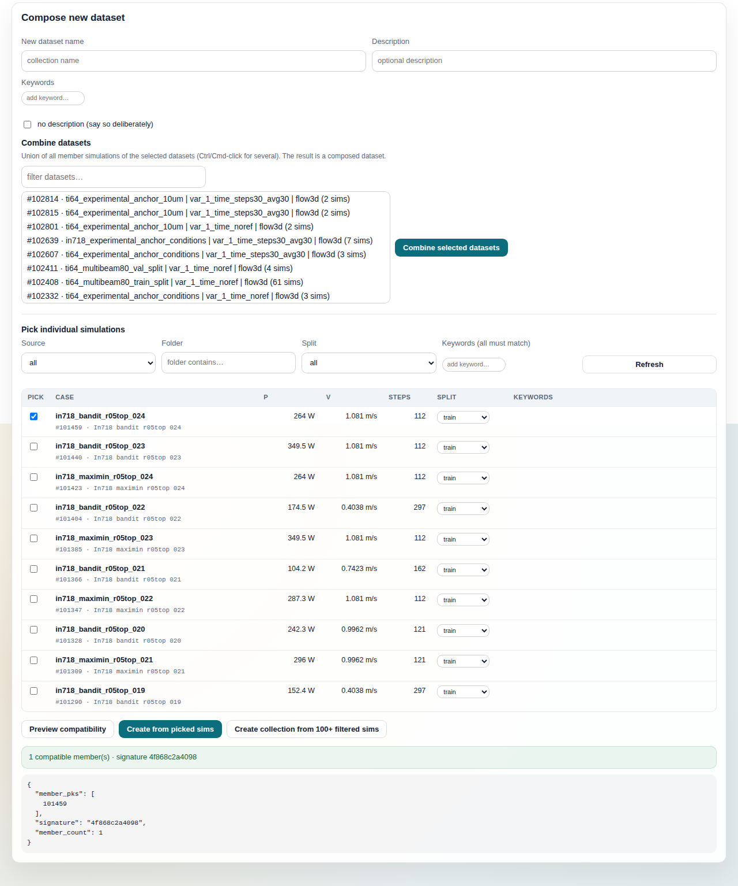

# Compose new dataset

The Compose tab builds a new `PinoDatasetCollectionData` node out of what is
already in your profile: either the union of whole existing datasets, or a
hand-picked or filter-selected set of individual simulations. The result is a
"composed" dataset, created through an AiiDA calcfunction so that every member
simulation and every source dataset is a real provenance input of the new node,
and it then appears in the [Datasets](datasets.md) tab like any other set.

The page is one panel with four regions, top to bottom: the new dataset's
metadata form, the "Combine datasets" picker, the "Pick individual simulations"
filter and table, and the result area under the action buttons. There is no
detail pane; the result area is where every action reports.

## What it shows

### Metadata form (top)

Three fields and a checkbox, shared by every create action on the page:
**New dataset name**, **Description**, **Keywords** (a chip input; press Enter
or pick from the suggestion list to add one, click `×` to remove), and the
**no description (say so deliberately)** checkbox. Nothing is read from the
server to render them. They are sent with the `POST /collections` body as
`collection_name`, `description`, `keywords` and `skip_description`.

### Combine datasets

A text filter and a multi-select list of datasets, with a **Combine selected
datasets** button beside it.

- Data source: `GET /datasets/options`
  (`AiidaConsoleService.dataset_options`). One projected QueryBuilder over
  `PinoDatasetCollectionData` reading `id`, `label`, `ctime`, the `folder`
  extra, `attributes.simulation_count` and the source folder name from
  `dataset_metadata`. It skips nodes whose `superseded` extra is true, so a
  collection that has been replaced by a content-identical successor is not
  offered. No node is loaded and no member statistics are computed; this is
  the cheap picker query, and the Datasets tab uses the full listing.
- Each option reads `#<pk> · <label> (<n> sims)`. Options show the full label
  because derived variants of one dataset share a display name and differ only
  in the derivation part of the label.
- Options are sorted newest first by `ctime`.

### Pick individual simulations

A filter row (**Source**, **Folder**, **Split**, **Keywords (all must
match)**, **Refresh**) above a table of simulations with columns Pick, Case,
P, V, Steps, Split and Keywords.

- Data source: `GET /simulations?source=…&folder=…&split=…&keyword=…&limit=…`
  (`AiidaConsoleService.list_simulations`, which calls
  `query_simulation_nodes`). It queries `PinoSimulationData` nodes ordered
  newest first by `ctime`, filtering on extras: `source_type` for Source,
  `split` for Split (`unassigned` also matches nodes with no `split` extra at
  all), and JSON containment on the `keywords` extra for Keywords, so every
  listed keyword must be present. Folder is a case-insensitive substring
  match on the `source_folder_name` extra, which is the ingest source folder
  recorded at import (unrelated to the console's filing folders in the
  Datasets tab).
- Per row it reads the simulation metadata (`get_simulation_metadata()`) for
  the case name, laser power, scan speed and time-step count, and the
  `split` and `keywords` extras. A node whose metadata cannot be read is
  skipped silently.
- The table shows one page of the match set. The page size is `listLimit`
  from `public/config.json` (100 by default). The button under the table
  reads "Create collection from N filtered sims", with a `+` after N when the
  page is full, to say the match set may be larger than what is shown.
- The Case cell shows the case name (the stem of the source NPZ, else the
  source group, else the simulation identifier) with `#<pk>` and the source
  folder's display name underneath.

### Result area

An initially empty block under the three action buttons. Every action writes
into it: a warning notice when a precondition is missing; a placeholder
while a request is in flight ("Combining…" for *Combine selected datasets*,
"Validating…" for *Preview compatibility*, "Saving…" for *Create from picked
sims*, "Collecting matching simulations…" for *Create collection from N
filtered sims*); then a green notice on success or a red one carrying the
server's error code, message and the first eight characters of the request
id (so the failure can be found in the backend log). Preview compatibility
also prints the raw response as a JSON block. "Loading…" is not drawn here:
it is the table area's placeholder while *Refresh* fetches rows, and a
refresh clears this block.

## Controls

Writes are marked **WRITES**. Everything else only reads the provenance store
or changes the page in the browser.

**Metadata form**

- *New dataset name*, *Description*, *Keywords*, *no description*: browser
  state only until an action sends them. *Combine selected datasets* and
  *Create collection from N filtered sims* refuse locally without a name
  ("enter a collection name") and without either a description or the
  checkbox ticked (a notice starting "enter a description" that ends by
  suggesting the checkbox); *Create from picked sims* checks only the name on
  the client. The server enforces both rules on every create
  (`InvalidRequestError`, HTTP 422); the client check exists so you are not
  told after the query has run.

**Combine datasets**

- *filter datasets…*: hides options whose text does not contain the typed
  string as one contiguous, case-insensitive fragment. Underscores in labels
  are read as spaces, so typing `random path` matches a label such as
  `alloy_random_path_val`; `alloy path` matches nothing, because the words
  are not adjacent in the label. Client-side only; no request.
- *Dataset list*: multi-select; Ctrl/Cmd-click to select several.
- *Combine selected datasets*: **WRITES**. Sends `POST /collections` with
  `dataset_pks` set to the selected pks and `simulation_pks` empty. The
  service (`create_collection`) loads each dataset, walks its
  `member_simulation_uuids` in order, and unions the members deduplicated by
  uuid. It then validates the member set (same source type and same field
  set across members; the grid may vary), computes the content signature
  from the member fingerprints, and looks for an existing non-superseded
  collection with the same `content_signature`. If one exists it is returned
  as `reused` and **nothing new is created**; otherwise a `compose_dataset`
  calcfunction runs with every source dataset and every member simulation as
  inputs and produces the new node with `dataset_role: "composed"`. The
  source dataset pks and uuids are also mirrored into the new node's
  `composed_from` extra (only if not already set), and the description and
  keywords from the form are written to the node's annotations. The result
  notice reports the pk and whether it was created or reused. On a reuse the
  form's description and keywords are still written to the existing node: a
  non-empty description overwrites its description, and a non-empty keyword
  list replaces its `keywords` extra outright (no merge).

**Pick individual simulations**

- *Source* (`all` / `flow3d`), *Folder*, *Split* (`all`, `train`, `val`,
  `test`, `unassigned`), *Keywords*: filter inputs. Changing them does nothing
  until *Refresh*.
- *Refresh*: reads `GET /simulations` with the current filters and one page
  of results, rebuilds the table, and clears every tick and the result area.
  A tick made before a refresh is discarded: the rebuilt table has
  fresh unchecked boxes and a hidden pick would otherwise still be sent.
- *Pick* checkbox: browser state only. Adds or removes the row's pk from the
  set sent by *Preview compatibility* and *Create from picked sims*.
- *Split* select in a row: **WRITES**, immediately. Changing it sends
  `POST /nodes/{pk}/annotations` with `{"split": …}`, which sets the
  simulation's `split` extra and appends a line to its `split_audit` extra.
  There is no confirmation; on a server error the select snaps back and an
  alert shows the message. It is the same control the Datasets tab shows in a
  selected case's detail, but here it sits in every row.
- *Keywords* chips in a row: **WRITES**, immediately. The `+` input that
  adds a chip is hidden until the table cell is hovered, and stays shown
  while anything in the cell has focus (the input once you have clicked
  into it, or a chip's `×` button), so a table of unannotated rows does not
  read as a column of empty boxes. Hovering the cell is the trigger, so a row
  with no keywords yet reveals its `+` box the same way. Adding a
  chip (Enter or a pick from the suggestion list) sends `keywords_add`;
  clicking `×` sends `keywords_remove`; both go to
  `POST /nodes/{pk}/annotations` and change the simulation's `keywords`
  extra. A chip keeps to one line and is cut with an ellipsis at the cell
  edge; its full text is in the tooltip. The row redraws with what the
  server returns.
- *Preview compatibility*: read-only. Sends `POST /preview/collection` with
  the picked pks; the service loads the nodes and runs
  `validate_collection_members` under the strict field policy, without
  creating anything. Success prints the member count, the compatibility
  signature (computed from the first member) and the JSON response
  (`member_pks`, `signature`, `member_count`). An incompatible set comes back
  as a 422 with `incompatible members: …` naming the mismatch. With nothing
  picked it only prints "pick some simulations" and sends nothing.
- *Create from picked sims*: **WRITES**. Sends `POST /collections` with
  `simulation_pks` set to the picked pks and no `dataset_pks`; the same
  create-or-reuse path as *Combine selected datasets*, with the picked
  simulations as the calcfunction's inputs. Refuses locally without picks or
  a name ("pick simulations and enter a name"). Unlike the other two create
  buttons it does not pre-check the description on the client; a blank
  description without the checkbox is refused by the server.
- *Create collection from N filtered sims*: **WRITES**. Re-runs
  `GET /simulations` with the current filters at the server's list cap (500,
  `list_max_limit` in the console settings) in place of the page size, then
  sends every returned pk to `POST /collections`. If the match count reaches
  the cap the page stops with a warning and creates nothing, because the
  collection would be silently truncated; narrow the filters and retry. Ticks
  in the table are ignored by this button.

*Combine selected datasets* and *Create from picked sims* are one request
each; *Create collection from N filtered sims* is two (the `GET
/simulations` re-run, then the `POST /collections`). There is no undo on
this page. A created collection can be deleted from the Datasets tab.

## How it relates to the other tabs

- [Datasets](datasets.md) is where a composed dataset lands. It lists at the
  top level with a `composed` role badge, its sources fold out under it from
  the `composed_from` extra, and the detail pane shows them as clickable
  "Composed from" chips. Splits are assigned there too: the detail pane's
  "Assign train/val/test splits…" fold-out draws them at random over the
  members with its *Assign* button, and its Cases table shows each case's
  split as a read-only chip; clicking a case opens its detail, where the
  same split select as this page's Split column sits next to the case name.
  Deleting, evicting, filing into folders and deriving a downsampled variant
  all happen there.
- [Models](models.md) lists the models trained and evaluated on these
  collections; it has no dataset picker of its own. In a build that ships
  the submission tabs, Train / Eval and K-Fold fill their training and
  evaluation dataset pickers from the same `GET /datasets/options` query as
  the Combine list, so a composed set is offered there as soon as it exists.
- [Runs](runs.md) shows the `compose_dataset` calcfunction as a finished
  process once a create action has produced a new node. The row is titled
  `compose_dataset` (the node label) over the friendly name "Compose
  dataset"; the process label itself is
  `compose_dataset_calcfunction.<locals>.compose_dataset`, which the
  console maps to that name by its last segment (hover the cell for the
  raw label). It falls under the `other` type filter, because the `dataset
  derivation` category matches on `Derive`. A reused
  collection produces no process.
- [Environment](environment.md) shows the profile the page is composing
  into. Composition does not need the daemon: the calcfunction runs inside
  the backend process, so this tab works with the daemon down.

## Empty state on a fresh profile

With no `PinoDatasetCollectionData` nodes, the Combine list renders empty and
*Combine selected datasets* prints "select at least one dataset". With no
`PinoSimulationData` nodes, the table shows "No rows." after the automatic
first refresh, the filtered-create button reads "Create collection from 0
filtered sims", and pressing it prints "no simulations match the current
filters" (after the name and description checks). *Preview compatibility* and
*Create from picked sims* print "pick some simulations" and "pick simulations
and enter a name". No request that creates a node can be sent from an empty
profile: the server refuses `POST /collections` with no members. Ingest
simulations first (the import path in the CLI, or the batch workchain) and
they appear here on the next *Refresh*.
