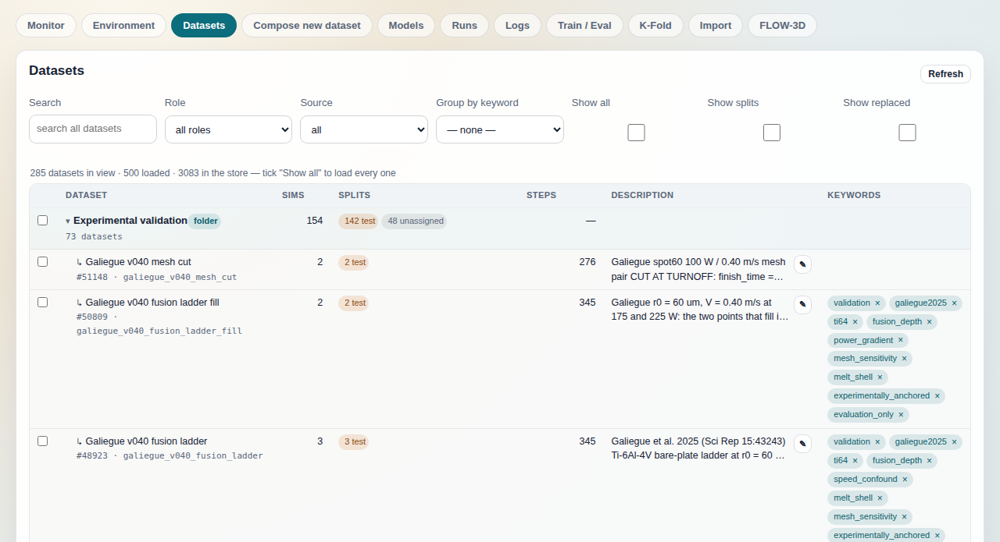
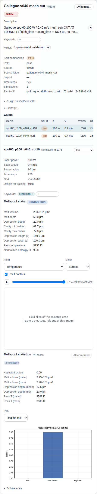

# Datasets tab

The Datasets tab is the browser for every `PinoDatasetCollectionData` node in
your AiiDA profile: which collections exist, which simulations each one holds,
how those simulations are split for training, and how the collections relate to
each other (base sweeps, derived views, composed unions, quick-validation
subsets). It is also where a dataset's human-facing metadata lives (folder,
keywords, description, splits), and where you look inside one case of a
dataset without leaving the browser.

The screenshot is from a development build with four more tabs on the right (Train / Eval,
K-Fold, Import, FLOW-3D), which this repository does not ship. Everything on this page is in
the console here.

## What it shows

The page is a two-pane browser (`browseTab` in `public/app.js`): the list on
the left, a detail pane on the right that fills when you click a row. Nothing
on it polls. The list is fetched on load and again by `Search`, `Show all`,
`Show splits`, `Show replaced` and `Refresh`; `Role`, `Source`, `Group by
keyword`, the folder toggles and the `▸` linked-set toggles re-render the
rows already loaded and send no request.

**The list.** One request, `GET /datasets` with the query parameters the
controls set (`role=all`, plus `limit=0`, `include_superseded=1`, `search=`),
served by `AiidaConsoleService.list_datasets`
(`src/aiida_pino/console/service.py`). The service projects every active
collection in one `QueryBuilder` query (`active_dataset_records`: pk, uuid,
label, description, ctime, extras, `dataset_metadata`,
`member_simulation_uuids`), then one more query over the union of all member
uuids for each simulation's `split`, `num_timesteps`, `effective_end_time_s`
and `data_evicted` extras. Superseded collections (`extras.superseded`) are
dropped unless asked for. Lineage is resolved before filtering: a recorded
`parent_collection_uuid` / `base_collection_uuid` attribute makes a row a
child of that parent; a small legacy name map (`_FOLDER_LINEAGE`) covers
older collections that predate the attribute; and a base collection whose
members are a strict subset of another collection's is shown as an inferred
`subset` of the smallest such superset. Only recorded lineage moves a dataset
into its parent's folder. Filtering (role, source, keyword, search) runs on
the resolved rows, and truncation is the last step: by default the list is
capped at 500 rows (`list_max_limit`), and `cap_dataset_rows` never drops a
row that sits in a real folder or carries the `core` keyword. The payload
also carries server-side aggregates: `total`, `truncated`, per-folder
counts (`folders`: the datasets filed directly in that exact path and their
distinct simulations) and keyword counts over the whole filtered population
(`keywords`). They are computed on the server because the same numbers
computed from a loaded page are wrong whenever the page is a subset. The
folder headers use those served
counts only while `Role` is `all roles` and no keyword group is chosen; see
"Folder headers" below for the other mode.

**Status line** under the controls: `N datasets in view · M loaded · T in the
store`, with ` — tick "Show all" to load every one` appended when the store
holds more than the page. "In view" counts the datasets the visible rows stand
for (a collapsed folder counts its members; an open one counts nothing, since
its members are rows of their own; a `+N more` row counts the N it hides);
"loaded" is what the last request returned; "in the store" is the server's
`total`. A part is dropped when it equals the one before it: `M loaded` is
omitted when it equals "in view", and `T in the store` when it equals
"loaded" (a search, which is uncapped, or `Show all`), so a search typically
reads `N datasets in view · M loaded` with no store total.

**Rows.** The table nests three ways:

- *Folders* (`folder` chip). A folder is the `folder` extra on the node, a
  slash-separated path (`src/aiida_pino/console/folders.py`); each path
  segment renders as its own collapsible header, so `A/B` is a sub-folder of
  `A`. A collection with no explicit folder inherits its recorded parent's.
  Unfiled collections sit at the top level. Two folders are computed at render
  time and stored on no node: `Single-run imports` (`auto` chip; every
  collection holding at most one simulation, kept last and collapsed) and
  `Self-improvement (AL)` (collections tagged `self-improve`). An open folder
  shows 100 members and a `+N more in <folder> — search to find one` row
  beyond that. That row goes through the dataset-row renderer, so it carries
  no checkbox, a `#more:<folder>` sub-line where a pk would be, `—` in
  **Sims**, **Splits** and **Steps**, a Description cell reading `—` with a
  `✎` button, and a Keywords cell whose `+` box appears when the cell is
  hovered. It stands for no node: a description or keyword saved from it is
  refused, because the annotations route takes an integer pk.

  *Folder headers* carry a `folder` chip, a `N datasets` sub-line, a **Sims**
  figure and **Splits** chips, and the numbers mean two different things
  depending on the controls. With `Role` at `all roles` and no keyword group,
  `N datasets` and **Sims** are the server's per-path totals: the datasets
  filed directly in that exact path and their distinct simulations, so a
  simulation shared by two datasets of the folder counts once and a
  sub-folder's members are not added to the parent. With any other `Role`, or
  a keyword group chosen, the header falls back to sums over the loaded rows
  of the whole subtree (sub-folders included): `N datasets` is the row count
  and **Sims** adds each dataset's `simulation_count`, so shared simulations
  count once per dataset. The header's **Splits** chips are always the
  subtree sum of the member rows' split chips, in both modes, which is why
  they can disagree with **Sims** on the same header even when the header
  sums its rows faithfully: a member dataset's own Sims figure and its split
  chips do not always add up.
- *Linked sets* under a dataset (`▸` toggle, `N linked` in the sub-line).
  Children are every row that records this one as its parent, whatever its
  role, plus the source datasets a composed set was built from
  (`extras.composed_from`). Two levels deep at most. A dataset renders once:
  in its own folder if it has one, else under the first parent that lists it.
- *Role chips* on non-base rows: `composed`, `derived`, `subset`.

Each row shows the display name (a prettified `source_folder_name`, else the
label), `#pk`, the source folder name, and any of: `replaced by #pk` (the
collection is superseded), `metadata only` or `partly evicted` (the count of
members whose `data_evicted` extra is set). The columns are **Sims**
(`simulation_count` from the collection metadata), **Splits** (chips counting
members by their `split` extra: train / val / test / unassigned), **Steps**
(the member `num_timesteps` when uniform; when they vary but every member's
time step agrees within 5 %, that step size as `Δt`; else a `min–max`
range), **Description** (`node.description`, clamped, with an edit button)
and **Keywords** (`extras.keywords` as chips; the `+` box that adds one is
hidden until the table cell is hovered or focused, so a row with no keywords
shows an empty cell until you point at it, and then the `+` box alone). A
keyword or split chip inside a table cell stays on one line, is cut with an
ellipsis at the cell edge, and carries its full text as a tooltip.

**Detail pane.** Clicking a row calls `GET /datasets/{pk}`
(`dataset_detail`), which loads the node and returns its summary
(`summarize_dataset_node`), description, keywords, superseded state, split
counts over its members, its folder (explicit, else walked up the recorded
parent chain and then the legacy name map, else the computed auto-folder),
and lineage chips: `derived_from` (the recorded parent, or the name-mapped
one), `derived_sets` (name-mapped children) and `composed_from`. The pane
shows, top to bottom:

- Name, `#pk`, the `Evict data…` and `Delete…` buttons (both write; see
  Controls).
- Description, keywords and folder, each editable in place (outside a table
  cell the keyword `+` box is always visible).
- A key/value block: split composition, role, source type (`flow3d` or
  `openfoam`), source folder, canonical layout, time steps, simulation count,
  chips for the parent / children / components (only the ones that exist),
  then the family identifier. A chip swaps that dataset's detail into the
  same pane.
- `Assign train/val/test splits…` (collapsed; writes).
- `Fields (N)`: the collection's `requested_fields` metadata.
- **Cases**: `GET /datasets/{pk}/cases` (`dataset_cases`) lists the members in
  the collection's own order, one `PinoSimulationData` query for the lot:
  case name (source NPZ stem, else source group), split, laser power, scan
  speed, time steps and grid shape from each simulation's metadata. The first
  100 render; `Show more (N hidden)` adds 200 at a time. In a 1280 px window the table
  is a few pixels wider than the pane and scrolls sideways inside its own
  frame to reach the grid column. A collection type without
  members (a plain `FolderData` legacy dataset) shows "No per-case browser for
  this dataset type." instead.
- **Case detail**, once a case row is clicked: the simulation's parameters
  (`laser_power`, `V_scan`, `beam_radius`, `num_timesteps`, grid,
  `usable_for_training` extra), a split dropdown (writes), its keywords
  (writes), its melt-pool stats and the frame viewer.
  - *Melt-pool stats* read `GET /simulations/{pk}/stats` without `compute`,
    which answers only from the `meltpool_stats` extra cached on the
    simulation. A case with no cache shows a `Compute now` button (see
    Controls); a case whose stored fields cannot yield melt metrics (reduced
    field sets) says so.
  - *Viewer*: `GET /simulations/{pk}/frames` returns the frame count, the
    times and the plottable array names (the simulation's `array_aliases`
    minus the coordinate and parameter arrays). Each frame is a PNG from
    `GET /simulations/{pk}/plot?field=&view=&frame=&contour=` rendered
    server-side by `console/viz.py` from the stored arrays: surface,
    longitudinal or transverse slice, optional melt contour, a slider and a
    play button.
- **Melt-pool statistics** for the whole dataset: `GET /datasets/{pk}/stats`
  (`dataset_stats`) reads the cached per-case stats of every member and
  aggregates them (regime counts, keyhole fraction, means and maxima of melt
  volume, depression depth, peak temperature); it never computes. Below it a
  `Plot` selector picks a PNG from `GET /datasets/{pk}/stats/plot?kind=`
  (regime mix, keyhole line, melt volume histogram, P–V map) rendered from
  the same cached rows.
- `Full metadata`: the raw detail payload as JSON.

## Controls

Read-only unless marked **WRITE**. Every write changes a node in your AiiDA
profile, all through `POST` routes except `Compute now` (the stats `GET` with
`?compute=1`), and the console has no undo except where noted.

- **Search** (`?search=`): filters on the server over the whole store,
  uncapped, matching label, family identifier, source folder name, folder,
  display name and description. A search also opens every folder except
  `Single-run imports`.
- **Role**: `all roles` keeps the tree; `base only`, `composed only`,
  `derived only`, `subsets / splits` flatten the list to that role. Client
  side, on the resolved role, from the rows already loaded: no request, and
  the folder headers switch to the client-summed counts described above.
- **Source**: `all` or `flow3d`, client side on `source_type`; no request.
- **Group by keyword**: lists every keyword carried by at least two datasets in
  the current result, with the server's count, and folds the datasets that
  carry the chosen one into one virtual folder `keyword: <name>`. No request;
  the folder headers switch to the client-summed counts.
- **Show all**: `?limit=0`, no cap. Otherwise the newest 500 are loaded.
- **Show splits**: also lists the automatic train/val/test split subsets
  (rows with a `subset_split` metadata value or filed under `Training
  splits`), which are otherwise hidden because each one is a view of a
  dataset already listed. It re-runs the list request with the same query.
- **Show replaced**: `?include_superseded=1`, so a collection retired by a
  newer node appears with its `replaced by #pk` chip.
- **Refresh**: re-runs the list request.
- **Folder toggles** and **`▸` linked-set toggles**: expand and collapse
  from the loaded rows; no request.
- **Selection checkboxes** (first column): tick rows, or a folder header to
  tick all its members. A bulk bar appears with the count (and how many
  ticked rows the current filter hides) and a folder input whose placeholder,
  `folder or folder/sub… (a new name creates it)`, may be cut short by the
  input's width. Its buttons:
  - **Move** (**WRITE**): `POST /folders/move` with the ticked pks and the
    typed path. Sets the `folder` extra on each node. A path that does not
    exist creates the folder; the computed folder names are refused. The
    autocomplete comes from `GET /folders`.
  - **Unfile** (**WRITE**): the same route with an empty path; removes the
    extra. A folder with nothing left in it ceases to exist.
  - **Undo** (shown after a move; **WRITE**): moves the same pks back to
    their previous folders, one `POST /folders/move` per distinct target.
  - **Add keyword…** (**WRITE**): `POST /nodes/{pk}/annotations` with
    `keywords_add` for each ticked pk in turn; stops at the first error.
  - **Clear**: drops the selection, no request.
- **Keyword chips** (list rows, the detail pane, and a case; **WRITE**):
  the `+` box (hover or focus the list cell to see it; always visible in the
  pane) adds and the `×` removes via
  `POST /nodes/{pk}/annotations`
  (`keywords_add` / `keywords_remove`), which rewrites the node's `keywords`
  extra.
- **Description `✎`** (list rows and the detail pane; **WRITE**): a prompt,
  saved through the same annotations route as `description`; it sets
  `node.description`.
- **Folder `✎`** (detail pane; **WRITE**): single-node `POST /folders/move`;
  an empty value unfiles. The pane notes `inherited from #pk` when the folder
  shown comes from the parent; saving here writes
  an explicit filing that overrides that inheritance from then on.
- **Case split dropdown** (case detail; **WRITE**):
  `POST /nodes/{pk}/annotations` with `split` on the simulation. Sets the
  `split` extra and appends the change to the simulation's `split_audit`
  extra.
- **Assign train/val/test splits… → Assign** (**WRITE**):
  `POST /datasets/{pk}/assign_splits` with three fractions (must sum to 1)
  and `only unassigned` (default on: members that already have a split keep
  it). Shuffles the candidates with a fixed seed, rounds by largest
  remainder, writes each member's `split` extra with its audit entry, and
  records the recipe (`split_recipe` extra) and an audit entry on the
  collection. Reselect the dataset to see the new
  chips.
- **Compute now** (a case with no cached stats; **WRITE**, and the one
  write on a `GET`): `GET /simulations/{pk}/stats?compute=1` reads every frame
  of the case (minutes for a long one) and stores the result in the
  simulation's `meltpool_stats` extra. `Compute missing (N)` on the dataset block does the
  same for the whole collection through `POST /datasets/{pk}/stats/compute`,
  25 cases per request, looping until none remain; cases that cannot yield
  metrics are counted as done and reported.
- **Evict data…** (detail pane; **WRITE, destructive**):
  `POST /datasets/{pk}/evict`. First call is a dry run that reports how many
  members would be evicted and how many bytes that frees; a confirm dialog and
  an optional note follow, then the real call deletes each member
  simulation's array data and keeps its metadata and provenance
  (`data_evicted` extra set). Members are shared between collections, so
  evicting here empties them in every collection that references them. A
  collection tagged `core`, or one whose members belong to a `core`
  collection, is refused. The call itself frees no disk: run
  `aiida-pino reclaim` afterwards, which deletes the unreferenced objects and
  repacks only the packs that held them. The confirm dialog says the space is
  reclaimed "on the next storage maintenance", and the alert after the
  eviction suggests `verdi storage maintain --full`, which also works but
  rewrites every pack.
- **Delete…** (detail pane; **WRITE, destructive**): `POST /nodes/delete`,
  dry run first (`aiida.tools.delete_nodes`) to list every node AiiDA's
  traversal rules would remove with it, then a confirm, then the deletion.
  Refused for a node tagged `core`.
- **Viewer field / view / contour / slider / play** and the stats **Plot**
  selector only change which PNG is requested. There is no progress figure
  for any of these: the pane shows `Loading cases…`, `Loading stats…`,
  `Loading melt-pool stats…` or `Loading viewer…` until the answer arrives
  (on the order of ten seconds each for the cases list and the stats block of
  a large dataset), a `Plot` switch keeps the previous image on screen until
  the new PNG lands (over a minute on a large dataset), and the first viewer
  frame can take longer still.

## Relation to the other tabs

- [Compose new dataset](../docs/compose.md) is where new collections come
  from: it unions or derives from the datasets listed here, and the result
  appears in this tab as a `composed` or `derived` row under its sources.
- [Models](../docs/models.md) names the dataset each model trained on and the
  datasets each evaluation scored; the folders, keywords and bulk-filing bar
  are the same `folderTools` component on both tabs.
- [Runs](../docs/runs.md) shows the workchains that produced these
  collections (imports, batches, derivations); a run's outputs link back to
  the dataset pk you look up here.
- [Monitor](../docs/monitor.md) and [Logs](../docs/logs.md) cover what is
  executing now and what it wrote; this tab is about what was stored.
- [Environment](../docs/environment.md) shows which profile all of this is
  read from. The Datasets routes need no daemon and no broker: the tab works,
  and every write on it works, with the daemon down.

## On a fresh profile

With no `PinoDatasetCollectionData` nodes the list request returns an empty
`datasets` array with `total` 0. The status line reads `0 datasets in view`,
the table says `No rows.`, `Group by keyword` offers only `— none —`, the
bulk bar stays hidden, the folder autocomplete is empty, and the detail pane
keeps its `Select a row.` placeholder. The controls still work and still
issue requests; the first dataset appears after an import or a Compose
submission finishes, and `Refresh` picks it up. A dataset with no cached
melt-pool stats shows `0/N cases` and a `Compute missing (N)` button in the
detail pane, and a case with no stats shows `Compute now`; the frame viewer
works from the stored arrays regardless.
