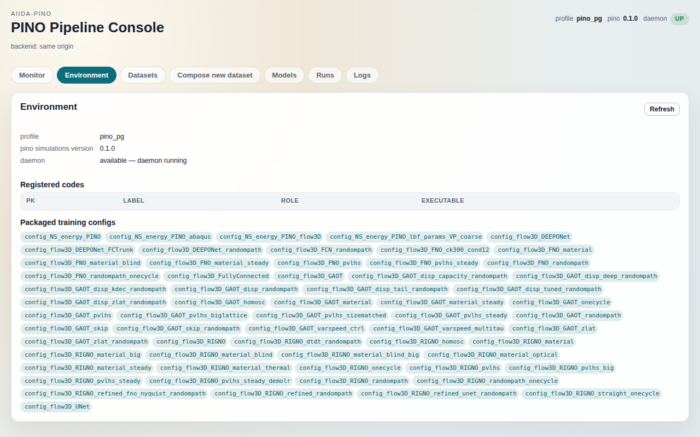

# Environment tab

The Environment tab shows what the console backend is running against: which
AiiDA profile it loaded, whether that profile's daemon can accept submissions,
which `InstalledCode` nodes exist, and which training configs the installed
`lpno` package ships. It is a read-only status page; use it to
check the deployment before submitting anything and to diagnose why the header
badge says the daemon is down.

The screenshot hides the rows of the Registered codes table; on your profile it
lists your own codes.

## What it shows

Everything on the page comes from one request, `GET /env`
(`AiidaConsoleService.env_status`), made once at page load and again on
Refresh. The page renders the cached payload; nothing on it polls.

**Header strip (top right, on every tab).** `profile`, `pino` (the installed
`lpno` version) and a `daemon` badge, `up` or `down` (the
stylesheet shows the badge and table headers in capitals). Hovering the
badge shows the daemon reason string. This strip is fed by the same `/env`
payload as the tab.

**Summary block.** Three key/value rows:

- `profile`: the name of the AiiDA profile the backend loaded, from
  `get_manager().get_profile().name`. It is whatever profile the backend was
  started with (the `aiida_profile` setting, or the AiiDA default).
- `pino simulations version`: `importlib.metadata.version("lpno")`
  in the backend's Python environment. `—` if the package is not installed.
- `daemon`: `available — daemon running` or `unavailable — <reason>`. The
  backend checks in two steps (`daemon_available`): the daemon client's PID
  file, then a real RPC (`get_daemon_info()`), because a stale PID file or a
  down RabbitMQ broker still passes the first check. The reason string says
  which step failed and what to start.

**Registered codes.** One row per `aiida.orm.InstalledCode` in the profile,
queried with `QueryBuilder` and sorted by label. Columns:

- `pk`: the node pk.
- `label`: `code.full_label` (`label@computer`). A label starting with
  `RETIRED-` or `RETIRED_` is greyed out and tagged `retired`; that is a naming
  convention read by the page (no node attribute is involved), so renaming a code that
  way is how you hide it from the submission pickers without deleting it.
- `role`: derived from the executable path and label by `_code_role`:
  `pvpython` if either contains `pvpython`; `shell` if the executable's
  basename is `bash`, `sh`, `zsh` or `dash`; `openfoam` if either contains
  `openfoam`, `foam` or `shell`; otherwise `python`. The role is what the
  submission forms filter on (they offer `python` codes).
- `executable`: `code.get_executable()`. When AiiDA cannot resolve it the
  backend sends an empty string, which the cell renders as `—`.

**Packaged training configs.** Chips listing every `config_*.yaml` in the
`lpno.conf.hydra` package resource directory
(`available_config_names`), sorted, without the `.yaml` suffix. These are the
`config_name` values a training or k-fold submission can pick. If
`lpno` is not importable the list falls back to the single default
config name.

## Controls

- **Refresh** (top right of the panel): re-issues `GET /env`, redraws the
  header strip and re-renders the tab. Read only. This is the only control on
  the page.

Nothing on this tab writes to the provenance store or to disk.

## Relation to other tabs

- The daemon state on this page gates every submission in a console with
  submission tabs, which this repository does not ship. The tabs here (Monitor,
  [Datasets](../docs/datasets.md), [Compose](../docs/compose.md),
  [Models](../docs/models.md), [Runs](../docs/runs.md) and
  [Logs](../docs/logs.md)) keep working when the daemon is down, because
  browsing needs only the database.
- The Registered codes table is the pool the submission forms' code pickers
  draw from (`codeSelect(role)` reads `codes.all` from the same payload).
- [Monitor](../docs/monitor.md) shows live process state; Environment shows
  whether new processes could be started at all. A Monitor that lists running
  jobs while Environment says the daemon is down means the daemon lost its
  broker or its PID file went stale; the jobs have not stopped.

## Degraded and empty states

- **`/env` fails.** `/env` walks codes, configs and versions and is the first
  request to time out on a busy backend. The page then falls back to
  `GET /healthz`, keeps only its `daemon` block, and shows a warning
  (`/env failed — showing /healthz daemon status only; press Refresh`) above a
  single `daemon` row. The header strip shows `profile —` and `pino —` next
  to the daemon badge: `/healthz` does return the profile name (alongside
  the daemon block, the service name and the served code version), but the
  page discards everything except `daemon`, so the strip has no profile or
  version to print (`/healthz` carries no `lpno` version at all).
  If `/healthz` answers without a `daemon` block (the backend is up but its
  service has not initialised) the tab shows `environment not loaded`
  instead. The line under the title reads `backend degraded: /env failed,
  using /healthz — HTTP 503` (the tail is the error `/env` returned: the
  error envelope's `code: message` when there is one, otherwise the bare
  HTTP status). Refresh retries the full request
  and, when it succeeds, redraws the strip and the tab in full. The line
  under the title, however, is only rewritten on a failure, so it keeps the `backend
  degraded` text until the page is reloaded. To tell whether the last Refresh
  worked, read the tab itself.
- **Backend unreachable.** The panel shows `environment not loaded`, the
  header strip stays empty, and the line under the title names the backend
  URL the page was pointed at and the page's own origin and suggests browsing
  the URL the backend was started with, since a cross-origin refusal reaches
  the browser as a bare `Failed to fetch`.
- **Fresh profile.** On a profile with no `InstalledCode` nodes the Registered
  codes heading is followed by `No rows.` and no table. The config chips still appear,
  because they come from the installed package. The
  daemon row reads `unavailable` until you have a RabbitMQ-backed profile with
  `verdi daemon start` running; the reason string names the missing piece.
