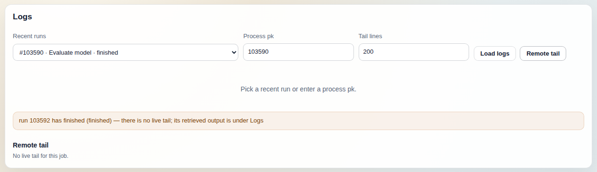
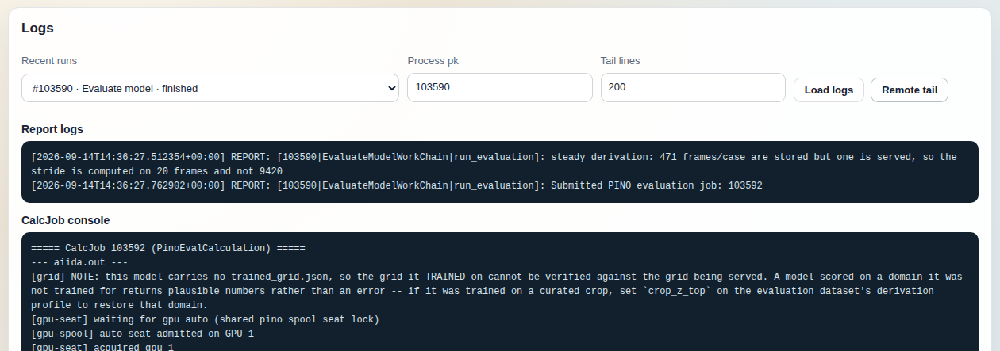

# Logs tab

The Logs tab shows the text a process left behind: the AiiDA report log of a
workchain and every process it called, the stdout/stderr its CalcJobs
retrieved, and, for a job that is still running, a live `tail` of the log file
in its working directory. It is the page to open when a run in Runs or Monitor
is not doing what you expected and you want to read what it said, without
`verdi process report` and an SSH session.

The screenshot shows a finished run after Remote tail: the pane says there is
nothing to tail and points at the retrieved logs instead.

## What it shows

**Controls row.** A `Recent runs` dropdown, a `Process pk` number field, a
`Tail lines` number field (default 200), and two buttons, `Load logs` and
`Remote tail`. The dropdown is filled from
`GET /processes?only_pino=true&limit=50` (`AiidaConsoleService.list_processes`)
every time the tab is rendered, so entering it again from another tab
re-requests the list; while the request is in flight the placeholder reads
`loading recent runs…`. The list is the 50 newest `ProcessNode`s by `ctime`
whose process type or label contains `pino`, or that link to a pino data node,
with smoke-test processes hidden.
Each option reads `#<pk> · <name> · <state>`, where the name is the console's
plain-English label for the process class when it has one (for example
`EvaluateModelWorkChain` shows as `Evaluate model` and
`WarmRuntimeCacheCalculation` as `Warm runtime cache`) and the raw class name
otherwise; the state is the AiiDA process state (`?` when the node records
none). The page keeps only entries whose `process_type` starts with
`aiida.` (workchains and CalcJobs): calcfunctions have no report log and no
console, so they would only ever render two empty panes.

**Report logs.** Filled by `Load logs`. `GET /processes/{pk}/logs`
(`process_logs`) loads the process and its `called_descendants`, collects every
`aiida.orm.Log` entry attached to any of them, and returns them sorted by time.
Each line renders as `[time] LEVEL: message`, so the pane is
`verdi process report` for the whole family in one place: a batch workchain's
own reports interleaved with those of the runs it submitted. `(none)` when the
family has no log entries.

**CalcJob console.** Filled by the same request. For every `CalcJobNode` in the
family, in order, a header `===== CalcJob <pk> (<process label>) =====` followed
by whichever of these exist, each under its own `--- <name> ---` line: the
scheduler stdout, the scheduler stderr, and the job's `output_filename`
(normally `aiida.out`) read from its `retrieved` `FolderData`. A CalcJob that
has none of the three yet (no scheduler output and nothing retrieved) gets no
header at all, so a job that has just been submitted is absent from the pane.
The text comes from the provenance store, so it stays available for as long as
the node exists, whatever becomes of the machine the job ran on. It is capped at `logs_max_chars` (200 000 characters by default) and
the cap keeps the end, which is where a failure usually is. `(none)` when no
CalcJob in the family has scheduler output or retrieved anything yet, which is
what a workchain still waiting on its first job shows.

**Remote tail.** Its own section below the two panes, filled only by the
`Remote tail` button. `GET /processes/{pk}/tail?lines=N` (`process_tail`)
finds the first `CalcJobNode` in the family and, if it has not terminated (a
job still `created`, `waiting` or `running`), opens that job's `remote_folder`
over the computer's AiiDA transport and runs `tail -n N` on the live log
file. The file it looks for first is the `lpno` live-tail log
(`.aiida_pino_live_tail.log`); if the job does not write one (a FLOW-3D solver
run, for instance) it falls back to the job's `output_filename` and says so in
a notice (`.aiida_pino_live_tail.log is not written by this job; showing
aiida.out`). The heading names the remote path that was read. `N` is clamped
to 1 to `tail_max_lines` (1000); a blank or non-numeric `Tail lines` field
sends 200. For a job on a remote computer the result is cached for a few
seconds (five by default), keyed by process pk, file and line count, and the
cache is shared across requests, so repeated `Remote tail` clicks on the same
job within that window, from one browser or several, share one SSH attempt;
a local job is read fresh every time.
This cache serves only this route: the Monitor's step-count read of the same
live-tail file goes through its own, longer cache and never calls
`/processes/{pk}/tail`.

The tail is best effort and never raises; what the section shows depends on
what the backend could read. The section is a warning notice carrying the
backend's note, shown only when the response has one, then the `Remote tail`
heading (with `· <path>` appended when a remote path was resolved), then one
of three things:

- The tail text in a log pane, when the file was read and was not empty. No
  notice when it was the live-tail file; the fallback notice above when it was
  `output_filename`.
- `No live tail for this job.` in muted text, when the backend returned no
  tail at all (`tail: null`), always with a notice. That is a family with no
  CalcJob (`no CalcJob in this process family yet`, heading without a path), a
  non-terminated job where `tail` failed on both the live-tail file and the
  fallback `output_filename` (`no live tail: <tail's stderr>`, heading with the
  live-tail path), and every terminated job: the notice then reads `run <pk>
  has finished (<state>) — there is no live tail; its retrieved output is under
  Logs`, heading without a path, where `<pk>` and `<state>` are those of the
  first CalcJob in the family, not of the workchain you asked for, because the
  scratch directory is normally gone by then and `/processes/{pk}/logs` already
  serves the retrieved output.
- `(empty)` in a log pane, when the backend returned an empty string. Four
  returns do that: a job that has no `remote_folder` yet
  (notice `no remote_folder output (job not yet running)`, heading without a
  path); a live-tail file that exists but has nothing in it yet (no notice,
  heading with its path); a fallback `output_filename` that exists but is
  empty (the fallback notice, heading with the fallback path); and a transport
  that raised while connecting or running the command, an unreachable computer
  for instance (notice `tail unavailable: <exception type>: <message>`, heading
  with the path it tried).

## Controls

All controls on this tab are read-only. Nothing here writes to the provenance
store, the daemon, or the remote computer; the only remote command issued is
`tail`.

- **Recent runs** (dropdown). Picking an entry copies its pk into `Process pk`
  and runs `Load logs`. When a pk was typed into the field instead, either
  button first resets the dropdown to match it (or to the placeholder when the
  pk is not among the recent 50), so the dropdown never shows a different run
  than the panes.
- **Process pk** (number). Any `ProcessNode` pk in the profile, including ones
  beyond the 50 listed. A pk that does not exist or is not a process node returns the
  backend's error in a red notice in place of the panes (`not_found: process
  <pk> not found` or `not_found: node <pk> is a <class>, not a process`).
- **Tail lines** (number, default 200). How many lines `Remote tail` asks for;
  ignored by `Load logs`.
- **Load logs** (button). Reads `/processes/{pk}/logs` and fills the Report
  logs and CalcJob console panes, clearing any earlier tail. With an empty pk it
  resets the dropdown to the placeholder and replaces the two panes with an
  `enter a pk` warning, so logs loaded earlier are gone from the page; an
  earlier Remote tail section is left in place in that case.
- **Remote tail** (button). Reads `/processes/{pk}/tail` and fills the Remote
  tail section under the panes, leaving the panes as they are. With an empty pk
  it resets the dropdown to the placeholder and replaces the tail section with
  an `enter a pk` warning. Runs `tail` on the job's computer through the AiiDA
  transport; it does not modify anything there.

The route also accepts a `path=` query parameter to tail a different file
relative to the job's working directory (absolute paths and `..` are refused);
the page does not expose it.

## How it relates to the other tabs

- [Runs](../docs/runs.md): the run detail pane has an `Open in Logs →` button
  that switches to this tab with the pk filled in and the logs loaded. This is
  the usual way in; the dropdown is for a run you already know by name.
- [Monitor](../docs/monitor.md): each active-run row, each pk in the GPU and
  FLOW-3D queues, and each live batch link opens here the same way. Monitor
  reads the same live-tail file to show a running training's step count,
  through its own cache; when its row says
  `starting…` for a job that has been up for a while, `Remote tail` here shows
  the raw file and whether it is being written.
- [Environment](../docs/environment.md): the registered codes, each labelled
  `label@computer`. A `Remote tail` that reports `tail unavailable` for a
  running job on one of those computers is usually a transport problem, which
  `verdi computer test` on that computer confirms.
- [Models](../docs/models.md) and [Datasets](../docs/datasets.md) do not link
  here; find the producing workchain in Runs and open it from there.

## On a fresh profile

With no pino processes in the profile the dropdown loads to
`— pick a recent run —` with no entries, the pk field is empty, and the pane
reads `Pick a recent run or enter a process pk.` Entering a pk of a node that
is not a process, or one that does not exist, shows the backend error. If the
backend cannot be reached the dropdown placeholder becomes
`(recent runs unavailable)` and the buttons return an error notice.

After your first submission the workchain appears in the dropdown the next
time the tab is rendered (leave and re-enter it, or reload); `Load logs` shows
its reports while it runs and `(none)` under CalcJob console until a job has
finished and been retrieved. `Remote tail` is useful in exactly that window,
once the job has a `remote_folder`.
