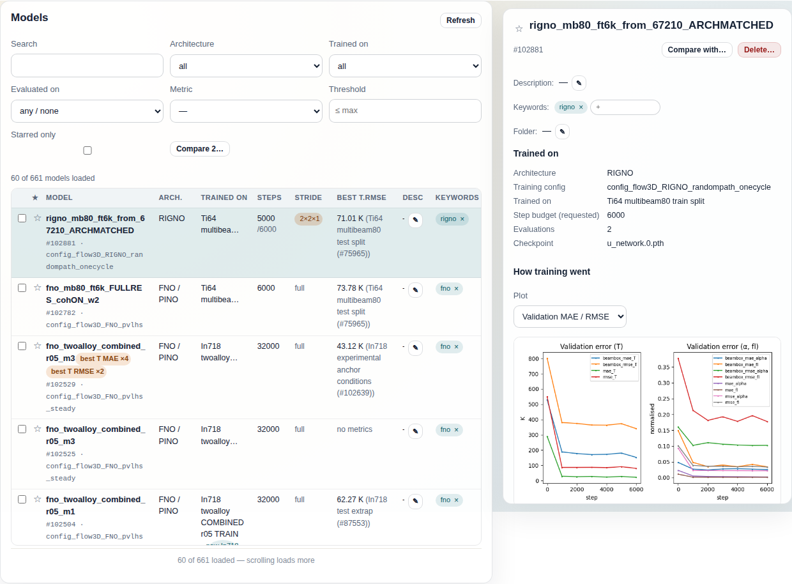
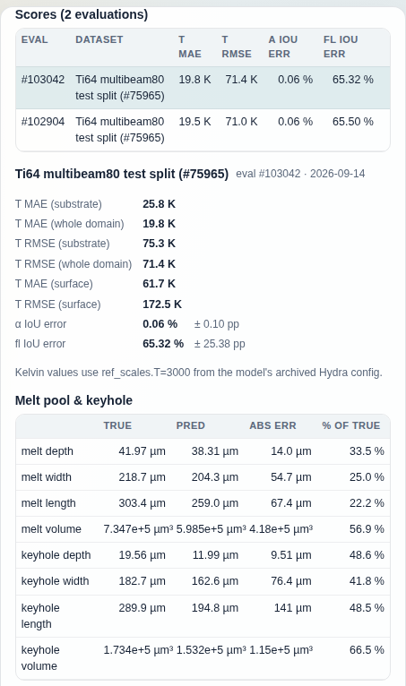

# Models tab

The Models tab lists every trained model in your profile (`PinoModelData`
nodes), newest first, with the dataset it trained on, how far it trained, the
grid it trained at and its best evaluation score, and opens any one into a
detail pane with training curves, every evaluation's scorecard, melt-pool
geometry and a ground-truth preview. It is the place to find a model, judge
whether two scores are comparable, referee an ablation between two models, and
file, tag or star the ones worth keeping.

## What it shows

The page is a two-pane split: the list with its filter grid on the left, a
detail pane on the right that reads "Select a model." until a row is clicked.
While the list loads, the left pane counts the seconds ("Loading… 12 s"),
because a model page on a large profile can take tens of seconds and a bare
"Loading…" is indistinguishable from a hung backend.

### Model list

`GET /models` (`AiidaConsoleService.list_models`) queries `PinoModelData`
ordered by `ctime` descending. Unfiltered browsing is paged: the first
request asks for 60 rows (`?limit=60&offset=0`) and a sentinel under the
table ("N of M loaded — scrolling loads more") fetches the next page when it
scrolls into view. The moment any filter is active the page asks for the
whole population instead (`?limit=0`, which the backend reads as "no cap"),
because the filters run in the browser and a filter over one page would
answer "no results" for a model that exists further down. A search is the
exception: it is sent to the server (`?search=`), which narrows on a
projection of `label`, `model_name` and `training_source_label` before it
builds any row, and every row it returns is shown; the browser does not
filter a search result again. The dataset field it matches is the training
dataset's node *label*. The display name the **Trained on** column shows is
derived from the dataset's source folder, so a word that appears only in the
display name finds nothing.

Each row is built from the model node and its evaluations:

- the node's `model_metadata` attribute (`model_name`, `config_name`,
  `training_profile`, `training_source_*`, `primary_checkpoint`);
- its extras: `keywords`, `folder`, `steps_trained`, `training_stride`,
  `full_resolution`, and `training_source_uuid`;
- every `PinoModelEvaluationData` whose `extras.model_uuid` points at it,
  fetched in one query for the whole page (`evaluation_metadata.metrics`,
  `metric_units`, and the extras `held_out`, `train_overlap_n`,
  `geometry_scale`);
- the training dataset's display name, resolved through the
  `PinoDatasetCollectionData` the model consumed and, if that collection was
  later merged, the survivor named in its `replaced_by_uuid` extra.

The line above the table names the population: "N models loaded" when every
loaded row is shown (a search result reads this way too), "N of M models
loaded" while paging, and "N shown of M" when a filter hides some of a fully
fetched population. A fourth form, "N shown of M loaded · T on the profile",
exists for a filter over a truncated page, which normal use does not produce
because a filter always fetches the whole population first. If that fetch
fails (a "Failed to fetch" notice replaces the list), setting the control back
to `all` redraws "0 of M models loaded" without a request; **Refresh** reloads
the page.

Columns:

- **checkbox**: selection for the bulk bar and for **Compare 2…**. A folder
  header's box selects the whole folder.
- **★**: the star toggle (see Controls). Starred models sort to the top of
  the rows that have been loaded. In paged browsing that is the loaded pages
  only: a starred model further down the profile stays out of sight until it
  is scrolled to, until **Starred only** is ticked, or until any other filter
  fetches the whole population.
- **Model**: `model_name` (falling back to the node label, then `Model <pk>`)
  in bold, followed by any automatic badge chips; beneath it `#pk · config
  name`. The badges are "best T MAE" and "best T RMSE", one per evaluation
  dataset, computed on every request and stored nowhere: the model whose
  best evaluation on a dataset has the lowest Kelvin error holds the badge
  until something beats it. A badge is only awarded in Kelvin, so a model
  whose temperature scale cannot be established never wins one, and an
  evaluation scored on the model's own training data (`held_out` false) is
  excluded from ranking. Identical badge texts on one row collapse into one
  chip with a count; hover for the datasets.
- **Arch.**: the architecture family (`FNO / PINO`, `RIGNO`, `GAOT`, …)
  derived from the config and run names by the same table that stamps the
  architecture keyword, so the label and the filter cannot disagree.
- **Trained on**: the training dataset's display name. The cell has two
  renderings. When that dataset is still live, the name is plain text clamped
  to two lines (tooltip "click to expand"; click toggles the clamp). When the
  dataset was since merged into another, the cell is not clamped: it shows the
  full name followed by a chip `now <survivor>`, and the cell's tooltip reads
  `merged into #<pk>`. The link to the node the model actually read is
  immutable, so the row names both. Chips in a list cell keep to one line and
  are cut with an ellipsis at the cell edge; this chip carries its full text
  in its tooltip.
- **Steps**: steps actually trained (`steps_trained` extra). When the run
  stopped short of its budget the cell shows `trained` over `/budget`; when
  only the budget is recorded it shows `≤budget` in grey. The budget is
  `training.max_steps` after Hydra overrides, which can differ from the
  profile field.
- **Stride**: the training resolution: `full`, or the loader stride the grid
  was downsampled by (`2×2×1`) as a warning chip. An error measured on a
  coarser grid is not comparable with one on the full grid. An em dash (`—`)
  when the node records no stride.
- **Best <metric>**: the minimum of one metric over the model's evaluations.
  The column picks one key for every row, the first of `T.rmse`,
  `T.rel_rmse`, `T.abs_err_mean` present anywhere in the loaded rows, so the
  column can be read down its length. Shown in Kelvin when the evaluation
  recorded its temperature scale, otherwise as the stored normalised value
  marked "(normalised)"; the dataset it was scored on follows in grey, and the
  tooltip says how many evaluations the minimum was taken over. "no metrics"
  when the model has no evaluation carrying that key.
- **Desc**: the node's `description`, clamped to two lines (click the text
  to expand it), with an edit button.
- **Keywords**: the node's `keywords` extra as removable chips plus an input
  to add one. The `+` input is hidden until the cell is hovered or holds the
  focus. A long keyword chip is cut with an ellipsis at the cell edge; its
  full text is in the detail pane.

Models filed in a folder (the `folder` extra) are grouped under a collapsible
header row named after the folder, showing its member count; unfiled models
sit at the top level. Folders are collapsed until clicked, and every folder is
opened while a search is active. Unlike the Datasets tab, nothing files a
model automatically.

### Detail pane

Clicking a row calls `GET /models/{pk}` (`AiidaConsoleService.model_detail`).
It returns the model summary (the same node fields as the list) plus the
Kelvin factor and its provenance, curve availability, and one processed row
per evaluation. The pane, top to bottom:

- **Title row**: star toggle, `model_name`, `#pk`, then **Compare with…** and
  **Delete…**.
- **Automatic badges**, when any, as the same orange chips the list uses
  (tooltip "assigned automatically from the evaluations, not a user keyword").
- **Description**, **Keywords**, **Folder**: the three annotations, each with
  its own editor (see Controls).
- **Trained on**: architecture, training config name, training dataset
  (and `now_named` when it was merged), the requested step budget, the
  evaluation count, and the primary checkpoint file name. The
  `training_source_kind` line is omitted while it says `dataset_collection`,
  which is every model the trainer produces.
- **How training went**: a plot rendered server-side from the training
  artifacts, `GET /models/{pk}/curves/plot?kind=validation|loss`. The
  validation curves come from the `events.out.tfevents*` file and the loss
  curve from the `[step: N] loss:` lines of the job stdout, both read off the
  `training_artifacts` folder linked as an input of the process that created
  the model (`model.creator.inputs.training_artifacts` and that folder's
  creator's `retrieved` output). When neither curve can be drawn the heading
  is followed by the reason. There are three: "no
  training artifacts linked to this model" (the creating process has no
  `training_artifacts` input), "training artifacts unreadable", and "no
  tfevents file and no job output recorded". A model brought in by
  `pino.import_model` does link the folder it was imported from, so it shows
  the third one: that folder holds no `events.out.tfevents*` file and no
  training calcjob stands behind it to supply a stdout. A payload with no
  reason at all falls back to "No training curves recorded for this model."
  The temperature axis is in Kelvin when the model's factor is known.
- **Scores (N evaluations)**: one row per evaluation: eval pk, dataset,
  T MAE and T RMSE in Kelvin (or `—` when the model's archived config gives
  no factor), α and fl IoU error,
  and its badges. Clicking a row selects it for the scorecard below; the newest
  evaluation is selected first. The row highlight does not follow that click:
  it stays on the first evaluation while the scorecard, geometry table and
  preview switch, so read the `eval #pk` line beside the scorecard heading for
  which evaluation is shown. The dataset name carries the collection's pk
  and, when its derivation is not the default, its stride (`(#1234, stride
  2x2x1)`), because two collections can share a display name and hold the same
  cases at different resolutions.
- **Scorecard** for the selected evaluation. If that evaluation's `held_out`
  extra is `false`, a red banner sits above the numbers. It reads
  "⚠ TRAINED ON N OF THE SCORED CASES -- training-fit, not a held-out result"
  when the evaluation's `train_overlap_n` extra records the count, and
  "⚠ SCORED ON TRAINING DATA -- training-fit, not a held-out result" when it
  does not; an unknown `held_out` stays silent. Then substrate, whole-domain
  and surface T MAE / RMSE; α and fl IoU error with their spread in
  percentage points; and a line naming the Kelvin factor.

  The rank line ("rank 2/7 · best 13.1 K · +0.6 K", or "rank 1/7 · best")
  appears on the whole-domain T MAE and T RMSE rows, and only on the
  evaluation that is the model's own best on that dataset for that metric.
  Each model enters a dataset's league once per metric, with its lowest
  Kelvin value (ties go to the older evaluation, so a badge does not flap), so
  a model's other evaluations on the same dataset carry no rank line, and the
  MAE and RMSE lines can sit on two different evaluations. Evaluations without
  a Kelvin value and evaluations on the model's training data are left out of
  the league; `N/of` counts the models in it.

  The Kelvin line names one source, the model's own archived Hydra config:
  "Kelvin values use ref_scales.T=3000 from the model's archived Hydra
  config." When that config yields no factor the line reads "Normalised units:
  <why> — no Kelvin conversion is shown rather than a guessed one", where
  `<why>` is "no archived Hydra config on this model", "archived Hydra config
  has no ref_scales.T" or "unusable ref_scales.T=<value>", and the scorecard
  and the Scores table print the stored normalised values. The numbers
  themselves are converted with the evaluation's own recorded
  `metric_units.temperature_scale_k` when it has one (attributes first, then
  the extras a backfill added) and with the model's `ref_scales.T` otherwise,
  but the pane shows Kelvin at all only when the model's config gives a
  factor; the list column is the one place an evaluation's own record stands
  alone.
- **Melt pool & keyhole**: true, predicted, absolute and relative error for
  melt and keyhole depth, width, length and volume, from the evaluation's
  `geometry.*` metrics. When the evaluation's `geometry_scale` extra records an
  anisotropic grid, x/y lengths and volumes are shown corrected and the table
  says by how much; depth is unchanged.
- A note that the keyhole/conduction split is not available: evaluations
  store set-wide aggregates only.
- **All N raw metrics** (collapsed): every stored metric key and value,
  as recorded. Some keys carry their unit in the name (`T.melt_threshold_K`,
  `geometry.melt_hd95_um`) and are not normalised.
- **Against ground truth**: the stored preview sample of the selected
  evaluation, `GET /evaluations/{pk}/preview` for the field list and grid
  shape, then `GET /evaluations/{pk}/preview/plot?field=&z=` for the image. It
  is read from the first `.npz` in the `eval_artifacts` output of the workchain
  that ran the evaluation (`eval.creator.caller.outputs.eval_artifacts`). A
  field selector and a z-slice slider redraw it. It is one case, batch 0 of
  the evaluation set; when the evaluation stored no preview the section
  disappears.
- **Training profile** and **Full metadata** (collapsed): the raw
  `training_profile` and the full detail payload as JSON. These contain
  whatever the training job recorded: Hydra overrides, the training machine's
  hostname and cache and output directories, GPU details. They are yours, but
  bear it in mind before screenshotting the pane with them open.

## Controls

Reads are marked as such; anything that changes the database is marked
**WRITE**.

| Control | What it does | Reads / writes |
| --- | --- | --- |
| **Refresh** | Discards the loaded rows and fetches the first page (or the full filtered population) again. | read, `GET /models` |
| **Search** (text) | Case-insensitive substring match sent to the server after a 300 ms pause in typing; matches `label`, `model_name` and the training dataset's node label (not its display name). Every returned row is shown. Opens every folder while non-empty. | read, `GET /models?limit=0&search=` |
| **Architecture** (select) | One of the families present in the loaded rows, or `all`. Options are rebuilt from the population. | read (client-side; the first use from a paged list fetches `GET /models?limit=0`) |
| **Trained on** (select) | Training dataset display name, or `all`. | read (client-side; the first use from a paged list fetches `GET /models?limit=0`) |
| **Evaluated on** (select) | Keeps models with at least one evaluation on the chosen dataset; `any / none` keeps everything, including unevaluated models. | read (client-side; the first use from a paged list fetches `GET /models?limit=0`) |
| **Metric** (select) | Any metric key seen on any loaded evaluation. Alone, keeps models with at least one evaluation (on the chosen dataset, if one is set) that records this key. | read (client-side; the first use from a paged list fetches `GET /models?limit=0`) |
| **Threshold** (`≤ max`) | With a metric chosen, keeps models with at least one qualifying evaluation whose stored value is at or below the number. It compares the stored value, which for `T.*` errors is the normalised one (`T.rmse` 0.0136, not 40.7 K). | read (client-side; the first use from a paged list fetches `GET /models?limit=0`) |
| **Starred only** (checkbox) | Keeps models carrying the `starred` keyword. | read (client-side; the first use from a paged list fetches `GET /models?limit=0`) |
| **Compare 2…** | With exactly two checkboxes ticked, replaces the detail pane with the referee's report (below). With any other number it prints how many are ticked and what to do. | read, `GET /models/{a}/compare/{b}` |
| Folder header row | Expands or collapses the folder. | none |
| Row click | Opens the detail pane. Clicking the clamped text of the **Desc** cell, or of a **Trained on** cell that has no `now …` chip (tooltip "click to expand"), toggles that clamp instead and does not open the pane; a **Trained on** cell carrying the chip is not clamped and opens the pane like the rest of the row. | read, `GET /models/{pk}` |
| **☆ / ★** (row or pane) | Adds or removes the `starred` keyword. A star is an ordinary keyword, so `aiida-pino tag <pk> --add starred` and `aiida-pino models --keyword starred` see the same thing. | **WRITE**, `POST /nodes/{pk}/annotations` with `keywords_add` / `keywords_remove` |
| **✎** on Desc (row or pane) | Prompts for a description and stores it on the node's `description`. Cancelling writes nothing. | **WRITE**, `POST /nodes/{pk}/annotations` with `description` |
| Keyword chips **×** / **+** (row or pane) | Removes one keyword, or adds the typed one on Enter or blur. In a list row the `+` input appears only while the Keywords cell is hovered or focused; in the pane it is always visible. The input suggests a fixed list of common tags (`keyhole`, `conduction`, `random path`, …); any text is accepted. | **WRITE**, `POST /nodes/{pk}/annotations` with `keywords_remove` / `keywords_add` |
| **✎** on Folder (pane) | Inline input for a `folder` or `folder/sub` path; Enter or **Save** files the model there, an empty path unfiles it, Escape cancels. A name that does not exist creates the folder; a folder exists exactly as long as something is in it. | **WRITE**, `POST /folders/move` (sets or deletes the `folder` extra) |
| Bulk bar: **Move** / **Unfile** | Appears once a checkbox is ticked. Files every selected model under the typed path (autocomplete from `GET /folders`), or removes them from their folders. Refuses the computed folder names the Datasets tab uses (`Single-run imports`, `Self-improvement (AL)`, `keyword:…`). | **WRITE**, `POST /folders/move` |
| Bulk bar: **Undo** | Shown after a move; puts the moved models back where they were. | **WRITE**, `POST /folders/move` per previous folder |
| Bulk bar: **Add keyword…** | Prompts once and adds that keyword to every selected model, one request each; stops at the first failure and says how many were tagged. | **WRITE**, `POST /nodes/{pk}/annotations` with `keywords_add` |
| Bulk bar: **Clear** | Unticks everything and drops the undo. | none |
| **Compare with…** (pane) | Prompts for another model pk and shows the referee's report in place of the scorecard. | read, `GET /models/{pk}/compare/{other}` |
| **Delete…** (pane) | Dry run of `aiida.tools.delete_nodes` on the model, then a confirm dialog listing every node that goes with it (the provenance cascade), then the real delete and a return to the tab. A model tagged `core` is refused before the dry run. Not undoable. | **WRITE**, `POST /nodes/delete` (dry run, then `dry_run: false`) |
| **Plot** (select, pane) | Switches between validation curves and training loss. | read, `GET /models/{pk}/curves/plot` |
| **Field** select and z slider (pane) | Redraw the ground-truth preview for another field or slice. | read, `GET /evaluations/{pk}/preview/plot` |
| Evaluation row click (pane) | Selects which evaluation the scorecard, geometry table and preview describe. The Scores row highlight does not move: it stays on the first evaluation, and the `eval #pk` line beside the scorecard heading names the one selected. | none |

One read has a side effect worth knowing: the first curve plot for a model
parses its tfevents file and caches the parsed series in a `curves_v1` extra on
the model node, keyed by the artifacts folder's uuid, so later renders skip the
parse. Nothing else on the read path writes.

All annotation and folder routes are broker-free, so starring, tagging,
describing and filing work with the daemon down. Every edit that uses a
`prompt()` writes nothing when cancelled.

### The referee's report

`GET /models/{a}/compare/{b}` (`aiida_pino.utils.model_compare.compare_models`)
lists every difference between two models and classifies each as `confound`
(changes the learning problem or the measurement: training data, seed, steps
actually trained, resolution, learning rate, batch size, mixed precision,
architecture and objective overrides), `caution` (can bias indirectly:
validation subset size, inference batching, unrecognised keys) or `benign`
(names, timestamps, GPU booking, device index). A fact missing on either side
is reported as `unknown`, never as equal. The verdict line takes one of five
forms. Two are green: `CLEAN: no substantive differences besides bookkeeping`
(or `CLEAN with N caution(s)`), and `SINGLE-FACTOR: only '<factor>' differs --
a valid ablation of that factor`. Three are red: `SINGLE-FACTOR with unknowns:
'<factor>' differs, but <facts> cannot be verified equal` (one measured
confound plus facts missing on a side, so the ablation is plausible but not
citable until they are resolved); `NO MEASURED DIFFERENCE: nothing this
comparison can measure differs, but <facts> cannot be verified equal`; and
`CONFOUNDED: N confounded factor(s): …` (with `; unknown: …` appended when
there are also missing facts). Only the head before the colon is bold. It
also says whether the two share their training data member-for-member and
flags any reconstructed (backfilled) facts in play. Below it, every dataset
scored by both models is listed with both T errors and a tick or cross for
whether that pair is legitimately comparable (same grid, both held out); when
no dataset was scored by both, it says there is nothing legitimate to compare
yet.

## Relation to the other tabs

- [Datasets](../docs/datasets.md) holds the collections named in **Trained
  on** and **Evaluated on**; the same folder layout, star, keyword and
  description editors, and bulk bar are shared code. The `(#pk, stride …)`
  suffix on an evaluation dataset here identifies exactly one collection
  there. ("What trained on this dataset" is answered by the CLI,
  `aiida-pino models --trained-on PK`; the console has no view for it.)
- [Runs](../docs/runs.md) lists the training and evaluation processes that
  produced these nodes; a `PinoModelData` appears in a training run's Outputs
  table, and deleting the run there deletes the model here.
- [Monitor](../docs/monitor.md) shows a training while it is still running;
  a model appears in this list only once its process has stored the node.
- [Logs](../docs/logs.md) has the full console of the training job whose
  `[step: N] loss:` lines the loss curve is drawn from.
- [Compose new dataset](../docs/compose.md) is where the training and
  evaluation collections these models consume are assembled.
- The list shows whatever the `aiida-pino` CLI or your own scripts
  train and import.

## On a fresh profile

With no `PinoModelData` in the profile the list reads "0 models loaded" over
"No rows.", every select offers only `all` (or `any / none` and `—`), the
metric column is headed "Best metric", and the detail pane stays at "Select a
model." The first model arrives when a `pino.train_model` (or `pino.train_eval`)
workchain finishes and stores its node, or when `pino.import_model` brings one
in; it lists with no evaluation, "no metrics" in the score column and "Not
evaluated yet." in the pane until an evaluation whose `extras.model_uuid`
names it is stored. Badges, ranks and the comparison report only become
meaningful once two models have been scored on the same collection.
