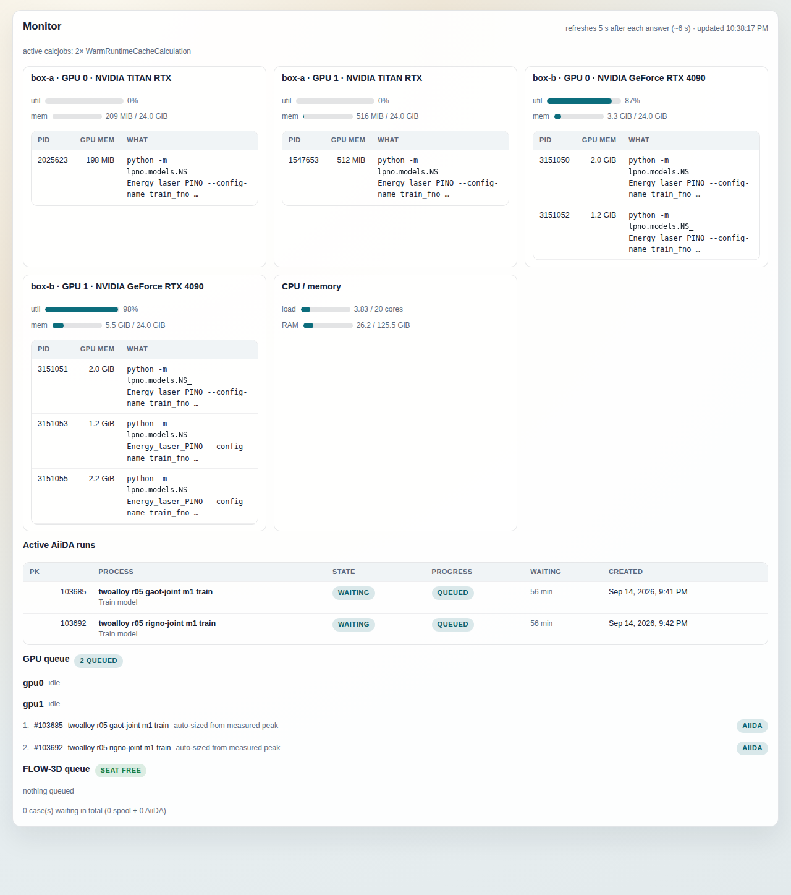

# Monitor tab

The Monitor tab is the console's live view of the machines behind your AiiDA
profile: which GPUs are busy, how loaded the CPU is, which pino processes are
active, and what is waiting for a GPU or for the FLOW-3D licence seat. It
exists because a training or a solve can be queued in three different places
(the AiiDA daemon, the `gpu_spool` ledger, the FLOW-3D task spool) and each of
them alone will report an idle machine while another holds it.

It is the first tab in the tab bar and the one the console opens on
(`index.html#monitor`).

## What it shows

Everything on the page comes from one request, `GET /monitor`, served by
`ConsoleService.monitor_status()` (`src/aiida_pino/console/service.py`). The
route runs without the RabbitMQ broker: every section that cannot be read
degrades to a note or an empty line instead of failing the page. The page
re-requests it 5 s after the previous answer arrives, so a slow answer cannot
pile requests up behind itself; the header line
reports the interval that is actually happening and the time of the last
answer. If a request fails, the last good snapshot stays on screen with a
red notice on top and the next attempt is 5 s later.

Region by region:

**Header line.** "refreshes 5 s after each answer (~N s) · updated <time>", the
time in the browser's locale format (`toLocaleTimeString()`, so "10:07:17 PM"
or "22:07:17" depending on the browser). The failure notice reads
"<error> — retrying in 5 s". Badge strings are quoted below as the code
writes them; the stylesheet displays every badge in capitals.
Below it, when any calcjob is active, a one-line tally such as "active
calcjobs: 2× Training job · 1× FLOW-3D solver run", built from
`aiida_calcjobs` in the answer: one `N× <name>` entry per class, joined with
" · ". The name is the console's display name for the process class
(`PinoTrainCalculation` shows as "Training job", `Flow3DRunCalculation` as
"FLOW-3D solver run", `WarmRuntimeCacheCalculation` as "Warm runtime cache");
a class the console has no name for prints as its raw process label. The
counts are `CalcJobNode`s
in state created/waiting/running, grouped by `process_label`, taken from the
same process query as the runs table below.

**GPU panels** (one card per GPU, headed `<host> · GPU <index> · <model>`).
The local cards come from `nvidia-smi --query-gpu` and
`--query-compute-apps` (`console/monitor.py: gpu_snapshot`); each compute
process is enriched with its command line and working directory from
`/proc/<pid>`. Cards on every non-local AiiDA `Computer` in your profile are
added by running the same two `nvidia-smi` queries on that box
(`gpu_rows_for_computer`) through a plain `ssh <host> <command>` subprocess
outside the AiiDA transport (`SshCommandRunner`, `BatchMode=yes`, a
15 s connect timeout and a 60 s command timeout, so a console without a tty
fails instead of blocking on a prompt). The host string is the `host` of the
computer's authinfo for the default user (`ssh_host_for`), which is what your
ssh config knows; if that lookup fails, the failure is logged with its
traceback and the console falls back to the computer's own hostname, then its
label. Results are cached per computer (5 s by default, the
`tail_cache_seconds` setting) so an unreachable box costs one slow attempt
per cache window. Remote compute processes are not
enriched from `/proc`, since that would describe a local pid. Each panel
shows a utilisation meter, a memory meter (used / total) and a table of
compute processes with PID, GPU memory and a "What" column:

- if the process's working directory or command line matches the remote
  workdir of an active pino calcjob, it shows that run's title (or process
  class) and `run #<pk>`;
- otherwise the command line, truncated, with the full line as a tooltip;
- a process the console could not read at all is still listed, as
  "unidentified process (pid N)".

An empty table reads "no compute processes" only when the process query
succeeded. When it failed on a remote box the panel says so and the meters
above are still trusted. If `nvidia-smi` is missing locally, or a remote box
could not be resolved, reached, or parsed, an amber notice at the top of the
page carries the reason (`gpu_note`) and the affected cards are simply absent.

**CPU / memory panel.** Load (1-minute average over `os.getloadavg()` against
`os.cpu_count()`) and RAM (used / total, from `/proc/meminfo` with used =
total − available). This is the machine running the console backend only.

**Active AiiDA runs.** One row per *top-level* active pino process: the
service queries every `ProcessNode` in state created/waiting/running, keeps
the ones whose process type or label mentions pino (or that link to a pino
data node), and folds each child into its top-level caller by walking the
`caller` link, so a batch with one running child is one row. Columns:

- PK;
- Process: the node's user title (`node.label`) in bold over its process
  class; hovering shows the raw process class (e.g. `TrainModelWorkChain`);
- State: the AiiDA process state as a badge;
- Progress: for a run whose family contains an active (created, waiting or
  running; a calcjob sits in `waiting` while it trains)
  `PinoTrainCalculation`, the console reads the tail of that calcjob's live
  log (`.aiida_pino_live_tail.log` in its remote working directory, locally
  or over the computer's transport, cached 30 s by default via
  `progress_tail_cache_seconds`) and shows a step bar
  `step N / max_steps`, with `max_steps` resolved from the run's
  `training_profile`. Under the bar sits the last beam-box MAE the trainer
  logged, in Kelvin when a scale could be resolved from the shipped config
  the run named, otherwise the raw value marked `norm.`. A run that logged
  "waiting for GPU seat" shows that badge instead. If the run holds no GPU
  process on any box that answered, or its log has not been written for
  15 minutes, the bar is replaced by the text "last seen step N / M · X ago"
  (the "/ M" only when `max_steps` resolved, the "· X ago" only when the
  log's age is known; the tooltip says why) and the MAE is withheld: a
  stopped job's log keeps its final step forever, and the page will not
  present that as progress. A calcjob whose log has no step yet shows
  "starting…". Runs with no training calcjob show "queued" or "—";
- Waiting: time since the top-level node was created;
- Created: the node's `ctime`.

**GPU queue.** The heading carries up to two badges, each shown only when its
count is non-zero: "N running", how many active AiiDA GPU runs are genuinely
running (a GPU process on a card, a running train/eval calcjob, or a live
log that has logged at least one step, and in every case not waiting for a
seat), and "N queued". Under it, one
line per `gpu*` directory of the pino GPU spool (`~/.pino/spool`) with what
that card holds right now: the spool task it is running, or "busy (AiiDA
seat)" when a lease in the `gpu_spool` ledger (`/var/tmp/pino_gpu_leases`,
or `PINO_GPU_LEASE_DIR`) is live on it or an AiiDA run's process sits on the
card, or "idle"; a badge with the number of
live seats and the VRAM they booked; and the first four seat-holder names.
Then the single ordered waiting list: AiiDA-submitted runs first in
submission order (each with the VRAM its training or evaluation profile
booked, "auto-sized from measured peak" when a training declared none, or
"exclusive card"), then spool-queued tasks. Each AiiDA entry is a `#pk` link.

**FLOW-3D queue.** The heading badge is the state of the licence seat,
`.seat.lock` in the FLOW-3D task spool (`~/.flow3d/spool`, or
`F3D_SPOOL_DIR`). Two separate reads feed it. Held or free comes from a
non-blocking `flock` probe of the lock file (`LOCK_EX | LOCK_NB`, released
at once when it succeeds): success means free, `OSError` means held. Who
holds it comes from the kernel's lock table, `/proc/locks`
(`monitor.seat_holder` / `parse_proc_locks`): the `FLOCK` line for the lock
file's inode gives the holder pid, lines whose second field is `->` are
processes blocked behind it, and the holder's `/proc/<pid>/cwd` is compared
with the remote working directory of each active `Flow3DRunCalculation`. The
badge then reads "seat in use · #pk" when that comparison matched a run,
"seat in use" when the lock is held by something the console could not
match, "seat between cases" when the probe did not report the lock as held
but a `Flow3DRunCalculation` is still counted running (with no holder in the
lock table that count falls back to the process state, so any
`Flow3DRunCalculation` in state `running`), "seat free" when the probe
succeeded and no run is counted running, and "seat unknown" when the probe
never ran (no spool directory, no `.seat.lock` file in it, or the file could
not be opened) and no run is counted running. Next
to it, when non-zero, an "N running" badge and an
"N queued" badge. That last number counts cases: a spool batch row
stands for all its tasks, and a live `Flow3DBatchWorkChain` contributes the
cases it has not materialised yet (`planned_runs − completed_runs` from its
extras), which exist only in its `run_configs` input and never appear in any
process listing. Below the heading:

- the spool tasks currently running, by name;
- the ordered queue: AiiDA-submitted FLOW-3D runs in submission order, then
  spool batches grouped by name with their case counts;
- one line per live batch with unmaterialised cases: a `#pk` link, the
  batch's title (or the word "batch" when the node has none), the text "N of
  M case(s) not yet started", and a "batch" badge at the right;
- any `queue_*` directories in the spool, which are parked work that will
  not drain ("held (not draining)");
- a total: "N case(s) waiting in total (X spool + Y AiiDA + Z batch case(s)
  not yet started) · H held aside", where the batch term appears only when
  Z is non-zero and the "· H held aside" suffix, outside the parentheses,
  only when a `queue_*` directory holds cases.

## Controls

The page has no buttons and no form. The only interactions are navigation:

- clicking a row of **Active AiiDA runs**, a `#pk` link in either queue, or
  the `#pk` of a batch line, opens that process in the [Logs](../docs/logs.md)
  tab. This changes the console's selected process and nothing else;
- the browser tab can be left open; polling continues while Monitor is the
  active tab and stops when you switch away.

Nothing on this page writes. `GET /monitor` reads the provenance store, the
spool directories and the lease ledger, and briefly takes and releases the
seat flock when it is free to probe it, which cannot disturb a real holder.
Killing, pausing or resubmitting a run is done from the
[Runs](../docs/runs.md) tab.

## Relation to the other tabs

- [Runs](../docs/runs.md) lists every pino process, terminal ones included,
  with the same title-over-class cell and progress cell; Monitor is the
  subset that is alive right now, plus the machine and queue state that Runs
  does not show. A queued FLOW-3D run's detail in Runs reads the same
  `GET /flow3d/queue` to say how many runs are ahead of it.
- [Logs](../docs/logs.md) is where every click on this page lands: the
  workchain report and the calcjob's console for the selected pk.
- [Environment](../docs/environment.md) is the static half of the same
  picture: the profile, the daemon, the configured computers and codes whose
  GPUs this page polls.
- [Datasets](../docs/datasets.md), [Models](../docs/models.md) and
  [Compose](../docs/compose.md) are unaffected by this tab; a run that
  finishes here appears in them once its workchain files its outputs.

## On a fresh profile

With no processes in the database the page still renders: a GPU panel per
local card (or an amber "nvidia-smi unavailable" notice and no cards on a
machine without one), the CPU panel, "no active runs", a GPU queue heading
with "no gpu spool on this machine" and "nothing queued", and a FLOW-3D
heading with "seat unknown" and "nothing queued". The spool directories and
the lease ledger are optional: their absence is reported, never treated as
an error, and the total line reads "0 case(s) waiting in total (0 spool +
0 AiiDA)". Remote GPU panels appear as soon as a non-local `Computer`
is configured in the profile and reachable; until then the page describes the
console's own machine only.
