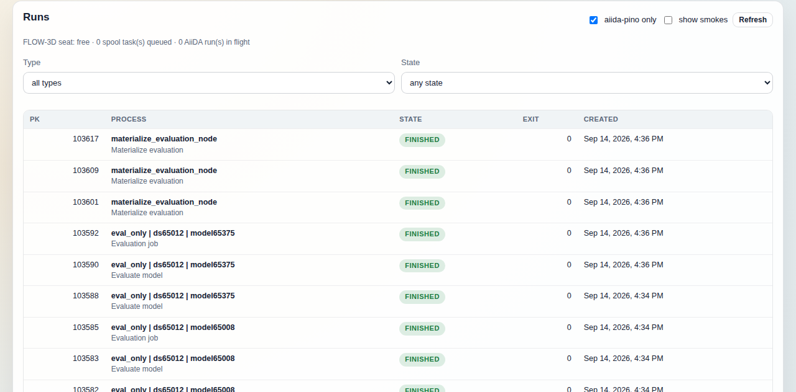
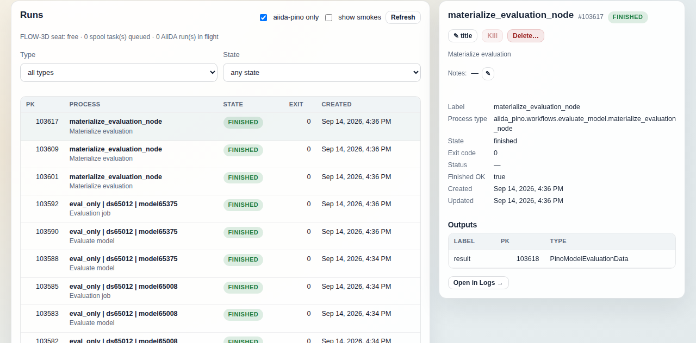

# Runs tab

The Runs tab lists the AiiDA processes in your profile, newest first, with
query-side filters by type and state, and opens any one of them into a detail
pane with its outputs, parsed summaries and live output. It is the place to
see why a run failed, name it, or stop it; the Monitor tab is for what is
happening right now, and the Logs tab for reading a run's full console and
report. There is no pk search here (the controls are two checkboxes,
**Refresh**, **Type** and **State**), so a known pk is found by eye within the
first page, or typed into the Logs tab, which takes one.

## What it shows

The page is a two-pane split: a list on the left, a detail pane on the right
that reads "Select a run." until a row is clicked.

### Seat and queue line

The grey line under the heading comes from `GET /flow3d/queue`
(`AiidaConsoleService.flow3d_queue_status`). It reads two things that are not
in the provenance store: the FLOW-3D task-spool directory (`~/.flow3d/spool`,
or `F3D_SPOOL_DIR`) and the kernel's lock table, to say whether the
`.seat.lock` inside that directory is held. From the provenance store
(`_aiida_flow3d_queue`) it queries the active `Flow3DRunCalculation`,
`Flow3DGenerateWorkChain` and `Flow3DBatchWorkChain` nodes (process state
`created`, `waiting` or `running`), but only two of the three are counted:
`run_count` is the number of active `Flow3DRunCalculation` calcjobs (each one
is either solving or blocked on the seat), `batch_count` the number of active
`Flow3DBatchWorkChain`s. Generate workchains match the query and are counted
in neither. The rendered pieces, separated by dots:

- `FLOW-3D seat: free`, `in use`, or `unknown`. When in use and the spool's
  `running/` directory has an entry, `by spool task <name>` follows. It
  names the task the spool worker started, which may differ from the
  process holding the lock. When the kernel's lock table names a holder, the
  suffix `, N blocked behind it` is always appended, with `N` the number of
  processes waiting on the lock, so it reads `, 0 blocked behind it` when
  nothing is waiting. The renderer also has a `by #<pk>` form for an
  AiiDA-held seat, but this route never fills `seat_holder.pk` (only the
  Monitor route resolves the holder to a calcjob), so on this tab an
  AiiDA-held seat reads as plain `in use`.
- `N spool task(s) queued` and `N AiiDA run(s) in flight`: both are shown
  because the two entry points take the same seat and either count alone
  reads as an idle machine while the other is saturated. The second is
  `run_count` above.
- `N batch workchain(s) active` (`batch_count`), only when non-zero.
- `N held aside (not draining)`: tasks in any `queue_*` sibling directory of
  the spool queue, which the worker does not drain.
- `running: ...` (every name in the spool's `running/` directory) and
  `next: ...` (the first three names in `queue/`, followed by `…` when more
  than three are queued).

Without a spool directory the line reads "FLOW-3D spool directory not found
(<dir>) — queue state unknown." (with the trailing full stop), and a failed
request reads "FLOW-3D queue status unavailable (<error message>)". Neither
hides the list.

### Process list

`GET /processes` (`AiidaConsoleService.list_processes`) runs one
`QueryBuilder` over `ProcessNode`, ordered by `ctime` descending. The type and
state filters are applied inside that query, so asking for failures returns
the most recent failures in the profile (a filter on the fetched page would
see only those among the most recent hundred rows). Two further filters are applied to the
result rows before the page is cut: the aiida-pino-only filter and the smoke
filter (see Controls). The page size is `listLimit` from
`web/public/config.json` (default 100), clamped by the backend's
`list_max_limit` (500); the query over-fetches three pages to fill one when a
post-query filter is active.

Columns:

- **PK**: the process node pk.
- **Process**: the node's `label` (its human title, if one was set) in bold
  over the friendly name of its process class; without a title only the
  friendly name; when the title is the same string as the friendly name, only
  the bold title, with no second line. The raw `process_label` and the
  description are the hover text. Friendly names come from a table in
  `app.js` (`Flow3DGenerateWorkChain` is "FLOW-3D run + ingest",
  `PinoTrainCalculation` is "Training job", and so on); an unknown class shows
  its raw label.
- **State**: the AiiDA process state as a badge. A `finished` process with a
  non-zero exit status gets the amber warning colour instead of the green
  success one; `excepted` and `killed` are red.
- **Exit**: `exit_status`; an em dash (`—`) when the node has none, which is
  every process that has not finished and every `excepted` or `killed` one.
  A cleanly finished process shows `0`, calcjob and workchain alike.
- **Created**: `ctime` in your browser's locale.

A footer reads "showing the N most recent matching runs"; the list never
paginates past the first page, so to find an old run, narrow the filters.

### Detail pane

Clicking a row calls `GET /processes/{pk}`
(`AiidaConsoleService.process_detail`), which loads the `ProcessNode` and its
outgoing `RETURN` and `CREATE` links.

From top to bottom:

- Title row: the node's title (or the friendly class name), `#pk`, the state
  badge, and the three action buttons (Controls, below). If a title is set,
  the class name is repeated underneath.
- **Notes**: the node `description`, clamped to two lines (click to expand),
  with an edit button.
- For a non-terminated process, a wait line: `<state> for <elapsed since
  ctime>`. It also calls `GET /flow3d/queue`, but the queue fields it looks
  for (`queue`, `seat_holder.pk`) are only populated by the Monitor route, so
  on this tab the line stays at state and elapsed time.
- A green notice for a prepare-only FLOW-3D run, when the run's
  `run_summary` output carries `prepare_only`: "Prepare-only run: the case
  was rendered and validated; no solve, no licence seat, and no dataset
  ingest." The workchain report says the same, but this pane does not fetch
  it.
- A key/value block labelled Label (the raw process class), Process type,
  State, Exit code, Status (AiiDA's `process_status`), Finished OK, Created,
  Updated.
- **Live output (last lines)**, a collapsed section shown only while the
  process is not terminated. Opening it calls `GET /processes/{pk}/logs`
  (`AiidaConsoleService.process_logs`) and shows the last 25 lines of the
  job's own stdout/stderr (`console`, collected from the CalcJobs in the
  process family and capped at `logs_max_chars`), falling back to the
  workchain's report entries (`Log` nodes) when there is no console; with
  neither it reads "(nothing written yet)". It reads once per open, and does
  not poll.
- **Exception**: the node's stored exception text, if any.
- **Outputs**: one row per outgoing link label (label, output pk, node class).
- **Parsed metrics**: the dictionaries behind outputs named `metrics`,
  `train_summary`, `eval_summary`, `run_summary`, `generation_summary` or
  `batch_summary`, as JSON. Absent when none of those outputs exist.
- **Open in Logs →**: switches to the Logs tab with this pk pre-filled.

## Controls

Reads are marked as such; anything that changes the database is marked
**WRITE**.

| Control | What it does | Reads / writes |
| --- | --- | --- |
| **aiida-pino only** (checkbox, on by default) | Keeps only processes that belong to aiida-pino: `pino` in the process type or label, or a `Pino*` node among the process's inputs or outputs (which is how a calcfunction run from a script is recognised). Untick it to see every process in the profile, including plain AiiDA ones. | read, `only_pino` on `GET /processes` |
| **show smokes** (checkbox, off by default) | Includes processes tagged with the `smoke` keyword (extras), which the VRAM-probe smoke runs carry. | read, `include_smokes` |
| **Refresh** | Re-runs the list query with the current filters. Does not re-read the seat line or the open detail. | read |
| **Type** (select) | `all types`, `data generation (FLOW-3D)`, `data import & conversion`, `model training / eval`, `dataset derivation`, `other`. Matched on `process_label` patterns in that precedence order (generation, models, conversion, derivation), so `ImportModelWorkChain` counts as models, not conversion; `other` is whatever matched none. | read, `category` |
| **State** (select) | `any state`; `queued / running` (`created`, `running`, `waiting`); `finished OK` (`finished` with exit 0 or no exit status); `failed / killed` (`excepted`, `killed`, or `finished` with a non-zero exit status). | read, `state` |
| Row click | Opens the detail pane for that pk. | read, `GET /processes/{pk}` |
| **✎ title** | Prompts "Run title (short, shown in the list; empty clears)" and stores the answer on the node's `label` column; empty clears it. The list and the Monitor tab's Active AiiDA runs table (both through `runNameCell`) show it in bold with the friendly class name on a second line beneath, or alone when it equals that name; the detail pane's title row shows it with the class name repeated underneath. | **WRITE**, `POST /nodes/{pk}/annotations` with `title` |
| **✎** next to Notes | Prompts for a description and stores it on the node's `description`. | **WRITE**, `POST /nodes/{pk}/annotations` with `description` |
| **Kill** | Sends a kill through the AiiDA engine (`kill_processes`, 5 s timeout). Enabled only while the process is not terminated and the header badge says the daemon is up; the backend refuses with 503 otherwise. A kill is a request to the daemon, not a guarantee: the pane shows "kill requested" and the row's state changes when AiiDA acts on it. | **WRITE**, `POST /processes/{pk}/kill` |
| **Delete…** | First a dry run of `aiida.tools.delete_nodes` on the pk, then a confirm dialog "Delete run <pk>? This affects N node(s): ..." listing every node that would go with it (a process's outputs and provenance descendants are deleted with it), then the real delete and an alert "deleted". Nodes tagged with the `core` keyword are refused at the dry-run request, so no dialog appears. Not undoable. | **WRITE**, `POST /nodes/delete` (dry run, then `dry_run: false`) |
| **Live output** (details toggle) | Fetches the last lines of the job console on open. | read, `GET /processes/{pk}/logs` |
| **Open in Logs →** | Navigates to the Logs tab for this pk. | read |

Every edit is done through a browser `prompt()`; cancelling it writes
nothing. The annotation route needs no daemon, so titles and descriptions can
be set while the daemon is down; Kill cannot.

## Relation to the other tabs

- [Monitor](../docs/monitor.md) answers "what is running now": it queries
  only active processes, adds training progress, GPU placement and the
  ordered FLOW-3D and GPU queues. Runs is the history, with the same row
  naming (`runNameCell` is shared) and the same seat line in reduced form.
- [Logs](../docs/logs.md) shows the full console and report for one pk, with
  a live tail; the detail pane here shows the last 25 lines once, and hands
  off with **Open in Logs →**.
- [Datasets](../docs/datasets.md) and [Models](../docs/models.md) show the
  *products* of these processes (the `PinoDatasetCollectionData`,
  `PinoModelData` and `PinoModelEvaluationData` nodes in the Outputs table).
  Deleting a run here deletes those products with it, which is what the
  confirm dialog is listing.
- [Environment](../docs/environment.md) is where the daemon badge that gates
  Kill comes from.
- The list shows whatever the `aiida-pino` CLI or your own scripts submit,
  under its class name, a moment after it is sent.

## On a fresh profile

With no processes in the profile the list shows "No rows." under the
filters and nothing else (no footer line). The same "No rows." appears on a
populated profile for any type and state combination that matches nothing.
The seat line reads "FLOW-3D spool directory not found (<dir>) — queue state
unknown." unless a `~/.flow3d/spool` directory exists, and "FLOW-3D seat:
free · 0 spool task(s) queued · 0 AiiDA run(s) in flight" once it does. The
detail pane stays at "Select a run." Submitting anything through AiiDA (a
`pino.flow3d_generate` workchain, an import, a training) puts its top-level
process and every child CalcJob and calcfunction in the list; untick
**aiida-pino only** to also see processes from other plugins.
